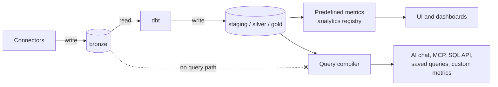
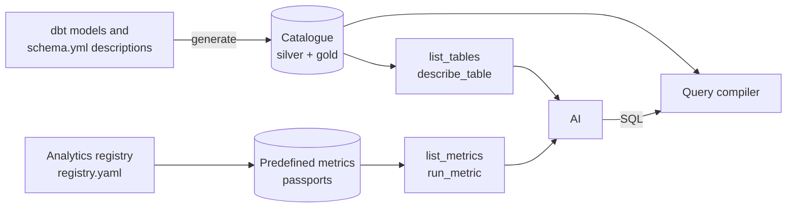
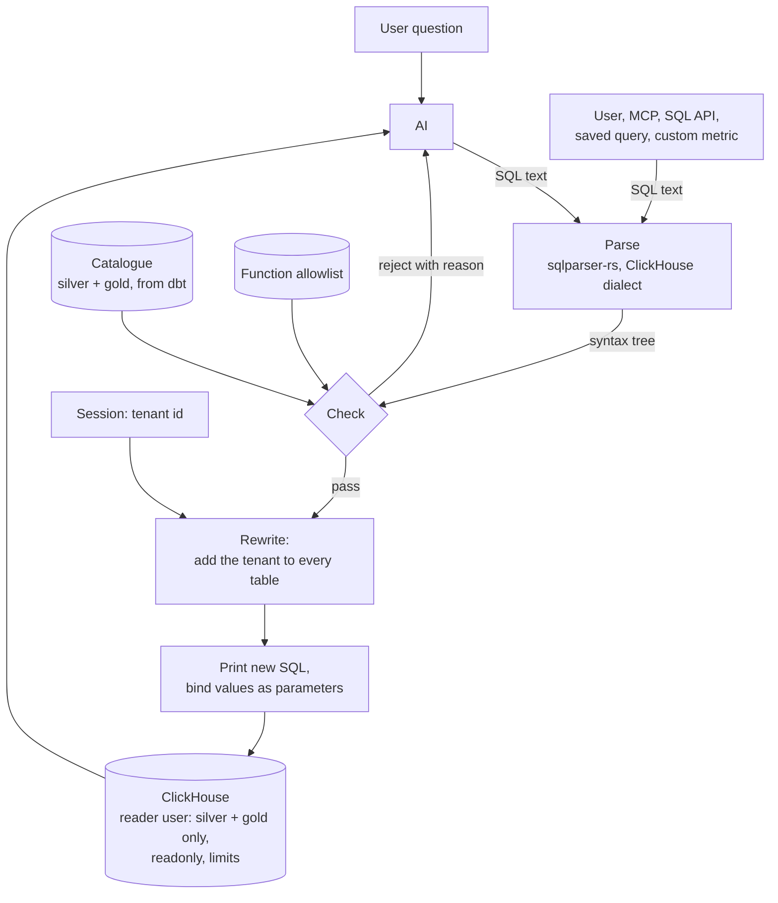
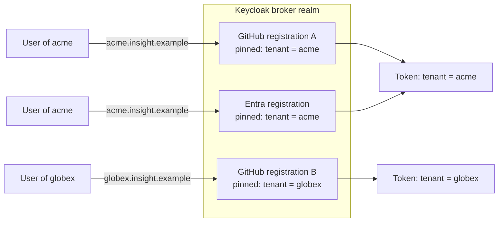
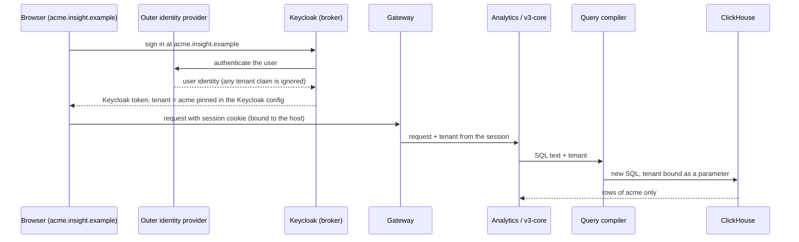

# Multi-tenancy

In plain words: what it takes for one Insight install to serve many tenants, who manages what, how people sign in, and how the data of one tenant stays away from other tenants. Tracking: design issue [#4299](https://github.com/constructorfabric/insight/issues/4299), gaps EPIC [#4376](https://github.com/constructorfabric/insight/issues/4376).

## TL;DR

- Today an install serves exactly one tenant, and its id is a chart value.
- The goal is many tenants in one install:
  - an operator with cluster access creates and removes tenants;
  - the same operator adds the connectors of each tenant and, where the identity provider cannot supply them, the roles.
- Insight has no tenant admin today. A tenant admin who configures their own tenant is a later step.
- Every tenant has its own subdomain, for example `acme.insight.example`. Its sign-in page lists the identity providers that tenant uses, and the user picks one.
- Every tenant signs in through an identity provider. Keycloak only brokers to those providers and stamps the tenant into the token.
- All tenants share the same warehouse tables. Every row has a tenant column.
- Queries that our code writes add the tenant filter themselves.
- Queries that users and the AI write go through one query compiler. The compiler parses the SQL, checks it, adds the tenant to every table, and writes new SQL. The original text never runs.
- Bronze is an input for dbt only. No user, admin or AI query reads it.
- A semantic layer describes silver and gold for the AI: a catalogue generated from dbt, plus the predefined metrics.
- Data isolation must land before a second tenant exists in an install.

## Where things stand

- **The tenant is a chart value.** It is set by `authenticator.oidc.defaultTenantId`, plus copies under `global.tenantDefaultId` and `ingestion.reconcile.tenantId`. The Keycloak config job stamps that one value into every login.
- **There is no tenant registry.** No table anywhere lists the tenants of an install.
- **Connectors are K8s Secrets.** Someone with cluster access applies them, and the reconcile job turns them into Airbyte and Argo objects, stamping them with the install-wide tenant. There is no API or UI for creating a connector.
- **Some paths run SQL that our code does not write, with no tenant scope:**

| Path | Who can use it | Tenant scope today |
|---|---|---|
| analytics MCP `query_sql` | admin | none |
| SQL API `POST /api/sql/query` | holder of the install-wide token | none |
| saved queries `/v1/queries/{id}/run` | any signed-in user | a `{tenant}` parameter that the SQL can ignore |
| custom metric `observation_sql` | any signed-in user | a filter on a `tenant_id` column that the user SQL itself produces; off today |
| insight-v3-core metrics (MCP, UI, chat) | admins write, all users run | none; a metric can name any `database.table` |

- **Most silver and gold tables have no correct tenant column yet** ([#2087](https://github.com/constructorfabric/insight/issues/2087)).
- **The isolation PRs of [#3661](https://github.com/constructorfabric/insight/issues/3661) merged into `feature/tenant-cutover`, not into `main`.**

## What needs to be done

### 1. Data isolation

Rows of different tenants never mix, and no query can read the rows of another tenant.

#### 1.1 Data

- One tenant value end to end.
- One tenant column, `insight_tenant_id`, in every staging, silver and gold table ([#2087](https://github.com/constructorfabric/insight/issues/2087)).
- The sort key of each silver and gold table starts with `insight_tenant_id`, so a tenant filter reads only the rows of that tenant.
- Tenant-scoped dbt.
- Tenant-aware MariaDB through the gears ORM.

#### 1.2 Who reads which layer



- **Bronze** holds raw JSON payloads. It is dirty and noisy. Only dbt reads it.
- **Predefined metrics** are queries that we write and review: the analytics registry. They add the tenant filter on every read, with no switch.
- **The query compiler** handles every query that a user or the AI writes.

#### 1.3 The semantic layer

The semantic layer tells people and the AI what the data means. The AI uses it to choose tables, columns and metrics before it writes a query.



The semantic layer has three parts:

1. **The catalogue.** A script generates it from dbt (`manifest.json` and `schema.yml`). It lists the silver and gold tables, their columns, types and descriptions, and optional relationships such as `person_id -> persons`.
   - It does not show `insight_tenant_id`.
   - It does not show technical columns: `_airbyte_*`, `unique_key`, `_version`.
   - It does not show bronze.
   - The dbt descriptions are the documentation for the AI. Their quality sets the quality of the answers.
2. **Predefined metrics.** The analytics registry (`registry.yaml`, documented in `passports.md`) defines measures, formulas, units and notes. We write and review these metrics. The AI can run a metric by its key, without SQL.
3. **The query compiler** (1.4). It uses the catalogue to check every query. It is the only path for SQL that a user or the AI writes.

The AI gets tools on top of these parts:

- `list_tables` and `describe_table` read the catalogue;
- `list_metrics` and `run_metric` use the predefined metrics;
- `run_sql` sends SQL to the query compiler.

**What exists today:**

- The analytics registry has about 118 measures. It stays as it is.
- insight-v3-core has datasets and a `MetricQuery` JSON: one table for each query, no joins, no tenant. Its future is an open question.
- The analytics MCP shows the schema through `system.tables` and `system.columns`. This shows bronze, the tenant column and technical columns. The catalogue replaces it.

#### 1.4 The query compiler

The compiler is the one place where SQL from users and the AI enters the system.



1. **Parse.** The compiler parses the SQL text into a syntax tree. It rejects any syntax that it does not understand.
2. **Check.** The compiler rejects the query when:
   - a table is not in the catalogue;
   - a column does not exist;
   - the query names `insight_tenant_id`;
   - a function is not on the allowlist.
3. **Rewrite.** The compiler adds the tenant from the session to every table in the tree.
4. **Print.** The compiler writes new SQL from the tree and binds all values as parameters.
5. **Run.** A reader user runs the SQL. This user can read only silver and gold.

**The function allowlist** fails closed. Only listed functions run. A new ClickHouse function stays blocked until we add it. The list does not contain functions that read data by name instead of by a table reference: table functions (`remote`, `url`, `file`, `s3`, `merge`, `cluster`, `dictionary`), `dictGet*` and `joinGet`.

**A rejected query** returns a clear reason. The AI uses the reason to write a new query.

#### 1.5 The tenant rewrite

Every table reference becomes a subquery with the tenant filter. This covers `FROM`, `JOIN`, subqueries, `IN (SELECT ...)`, `WITH`, `ARRAY JOIN` and `UNION`, because SQL has no other way to name a table.

The AI writes:

```sql
SELECT p.department, count() AS commits
FROM silver.class_commits AS c
JOIN silver.persons AS p ON p.person_id = c.person_id
WHERE c.committed_at >= now() - INTERVAL 90 DAY
GROUP BY p.department
```

The compiler runs:

```sql
SELECT p.department, count() AS commits
FROM (SELECT * FROM silver.class_commits WHERE insight_tenant_id = {tenant:UUID}) AS c
JOIN (SELECT * FROM silver.persons WHERE insight_tenant_id = {tenant:UUID}) AS p
  ON p.person_id = c.person_id
WHERE c.committed_at >= now() - INTERVAL {p1:UInt32} DAY
GROUP BY p.department
```

#### 1.6 Where the tenant comes from

The tenant is pinned in the Keycloak config, for each identity provider registration. Insight does not trust a tenant from an outer identity provider. No request, query or tool argument can set the tenant.



- **One identity provider registration belongs to one tenant.** When the operator adds an identity provider to Keycloak, the operator pins the tenant id in the hardcoded mapper of that registration.
- **Every user who signs in through that registration gets that tenant.** The value comes from the Keycloak config, not from the user or the provider.
- **A tenant can have more than one identity provider.** Each registration has its own mapper with the same tenant id.
- **The tenant never comes from the outer identity provider.** We cannot trust it. Keycloak ignores any tenant value that the provider sends.
- **The same provider can serve more than one tenant.** Each tenant gets its own registration, so the mapper values do not mix.
- **The operator with cluster access configures the registrations.** There is no API or UI for this.

After sign-in, Insight uses only the pinned tenant:



#### 1.7 Changes to the current paths

| Path | Change |
|---|---|
| analytics MCP `query_sql`, SQL API | Use the query compiler. Bronze is no longer readable. |
| saved queries, custom metric `observation_sql` | Use the query compiler. Stop using the main analytics ClickHouse user. |
| insight-v3-core metrics | Add the tenant rule. Remove `SELECT ON *.*` and the fallback to the admin client. |
| predefined metrics (analytics registry) | No change: the tenant filter is always on. |

### 2. Tenant registry

A tenant becomes a record, not a single chart value. Roughly:

- id (UUID) and name;
- status: active, suspended, deleting;
- its subdomain;
- its identity providers: at least one is required.

An operator with cluster access manages the registry; there is no admin UI above tenants for now. Once the registry exists, the chart copies of the tenant go away. Related: [#725](https://github.com/constructorfabric/insight/issues/725).

### 3. Sign-in and routing

**Every tenant has its own subdomain.** `acme.insight.example` belongs to one tenant, and the subdomain alone tells which tenant a visitor means. No e-mail domains are involved.

- **The sign-in page is per tenant.** It shows that tenant's branding and the identity providers it uses (for example GitHub, Entra, Google), and the user picks one.
- **Keycloak is a broker only.** It holds no users of its own. Each tenant's identity providers are registered in Keycloak separately, and each registration has a mapper with that tenant's id hardcoded. The tenant in the token always comes from that value, never from what the provider sends.
- **One person in several tenants works naturally.** The same GitHub account signs in at `a.insight.example` and at `b.insight.example`. These are two registrations, two sessions and two tokens, each carrying its own tenant. The session cookie is bound to the host, so the sessions never mix.
- **DNS and TLS are set once per install, not per tenant.** A wildcard DNS record and a wildcard certificate (`*.insight.example`) cover all subdomains. A new tenant needs only its redirect URIs in Keycloak.

### 4. Connectors and roles

The operator with cluster access configures every tenant. There is no API or UI for this.

- **Users come from the identity provider.** Insight does not create, invite or remove users.
- **Connectors stay K8s Secrets.** Each Secret names its tenant. The operator applies it.
- Ingestion takes the tenant from each connector Secret, never from an install-wide setting.
- The reconcile job never takes over a source or connection of another tenant.
- All tenants share the bronze tables. An Airbyte Clear or Refresh of one connector must not remove the rows of other tenants.
- **Roles** are managed in Insight only where the identity provider cannot supply them. The operator assigns them. Today the `roles` table has no tenant, so it needs one.
- Connector health and similar views show the caller's tenant only.

### 5. Tenant lifecycle

- **Create:** the operator adds the registry record, registers the identity providers of the tenant in Keycloak, and adds the redirect URIs. This is one operation that can be verified.
- **Suspend:** nobody can sign in, and syncs are paused.
- **Delete:** remove the tenant's data in every layer and store, its connectors and their Airbyte and Argo objects, and its identity provider registrations in Keycloak. This is one operation that can be verified and produces a report.

### 6. Operations

- **No tenant, no access.** Without a tenant there is no sign-in, so no connectors and no work that could write a record without a tenant. A request, job or record that reaches the system with an empty tenant is a fatal error, never something to fall back from.
- Quotas and limits per tenant: connectors, sync frequency, query load ([#724](https://github.com/constructorfabric/insight/issues/724)). All tenants share one ClickHouse reader user, so the query compiler sets a quota key per tenant.

## Not now

Each of these is a separate task, picked up once there is an explicit requirement:

- **An admin UI above tenants.** For now, cluster access is that role.
- **A tenant admin.** A role inside a tenant that configures that tenant without cluster access. It needs:
  - an API and a UI for connectors and their secrets;
  - storage and encryption of the secrets, so that one tenant's admin never sees the secrets of another tenant;
  - restricted egress for connectors, because they run inside the cluster against URLs that the tenant admin types in (SSRF);
  - role management for the tenant;
  - an audit of what tenant admins do.
- **A tenant hierarchy:** a main tenant with subtenants, and their subtenants. An organization with departments is one tenant. Departments are data inside that tenant.
- **Users kept by Insight itself**, for a small organization without an identity provider of its own.
- **Cells:** groups of 5 to 10 tenants, each group with its own ClickHouse and services, behind a router. The subdomain makes the routing simple. The first install is one cell.

## Rejected options for data isolation

| Option | Reason |
|---|---|
| A tenant filter in application code only | SQL that users and the AI write does not pass through it. |
| A ClickHouse row policy keyed on a custom setting | The SQL text can change the setting. |
| One ClickHouse user per tenant | It needs too many connections. |
| One ClickHouse database and role per tenant | It needs about 480 tables per tenant and one dbt run per tenant. The role in each request is a fragile point. |
| A new query language | It costs too much, and AI questions need more than a simple language gives. |

## Open questions

- For the later tenant admin: how are connector secrets stored and encrypted, so that tenant isolation also holds for them?
- How do roles or groups from an identity provider map to Insight roles?
- Function allowlist: which functions go on it? A test on real AI queries shows how much the parser and the list block.
- insight-v3-core: does it use the query compiler, or keep its own compiler with the tenant rule?
- Relationships for the catalogue: do they come from dbt tests and meta, or from a separate file?
- **Org chart and the AI.** The AI knows nothing about the org chart:
  - Access: can a manager see only their own subtree inside the tenant? If yes, the compiler needs a second scope from the session, and tables without a person key need a rule.
  - Answers: the catalogue must describe the org tables, and the AI must know the position of the user in the org chart.

## Order

1. Data isolation (block 1) comes before a second tenant exists in an install. Its first step is the tenant column in every table ([#2087](https://github.com/constructorfabric/insight/issues/2087)).
2. The registry and sign-in (blocks 2–3) can run in parallel with it. They touch the authenticator, identity and Keycloak, not dbt or the warehouse.
3. Connectors and roles per tenant (block 4) come after the registry and sign-in.
4. Lifecycle and operations (blocks 5–6) come last.
